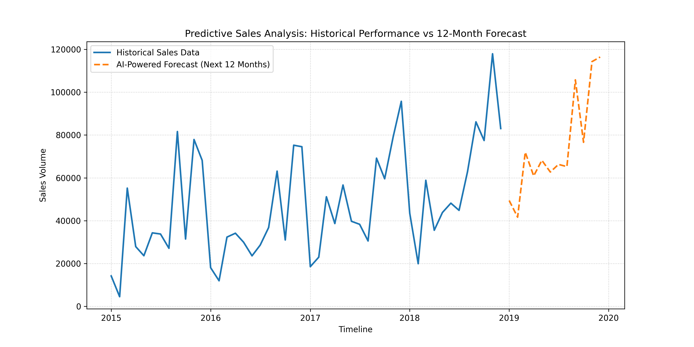

# 📈 Sales Forecasting Analysis (Time Series)

## 📌 Project Overview
This project focuses on **Predictive Business Analytics** to forecast future sales performance. By applying advanced Time Series modeling techniques to historical transaction data, I isolated underlying market trends and seasonal spikes to predict sales trajectories for the upcoming year.

## 🎯 Objectives
*   Analyze historical sales trends to discover macro-level business trajectories.
*   Incorporate seasonality adjustments to handle recurring annual retail peaks.
*   Implement a **Holt-Winters Exponential Smoothing** model to forecast the next **12 months** of revenue.
*   Generate stakeholder-ready visual assets and clean CSV data pipelines for business decision support.

## 🛠 Tools & Technologies
*   **Language:** Python (Pandas, Numpy)
*   **Statistical Modeling:** Statsmodels (`ExponentialSmoothing`)
*   **Data Visualization:** Matplotlib (Advanced Plot Customization)
*   **Workflow Automation:** Python `os` and `warnings` management

## 📊 Methodology & Data Pipeline
1.  **Data Ingestion & Chronological Sorting:** Streamlined raw ingestion from `raw_sales.csv` and handled European date formats programmatically (`dayfirst=True`). Sorted all records sequentially to preserve chronological chain integrity.
2.  **Time Series Aggregation:** Resampled high-frequency daily data into **Monthly** totals. This step successfully removed short-term operational noise, allowing the statistical models to capture long-term seasonal movements.
3.  **Trend & Trajectory Diagnostics:** Programmatically cross-referenced the earliest and latest sales baselines to map out a clear historical trajectory, printing macro-level trends directly to the business console.
4.  **Forecasting Pipeline:** Configured and fitted a Triple Exponential Smoothing model, exporting 12 months of clean predictive data straight to `forecast_values.csv`.

## 📈 Statistical Modeling & Forecasting Philosophy
Time series data requires a structured decomposition of trend and seasonality before projection. Instead of treating the dataset as a flat linear regression, this project applies **Triple Exponential Smoothing (Holt-Winters Method)**:

*   **Additive Trend (`trend='add'`):** Applied to capture steady, systematic growth/decline over time without exponential compounding risks.
*   **Additive Seasonality (`seasonal='add'`):** Integrated with a strict **12-month period frequency** (`seasonal_periods=12`) to catch recurring annual patterns (e.g., holiday spikes or end-of-quarter surges).
*   **Stakeholder Delivery:** Configured the evaluation script to automatically bypass statistical logging alerts (`warnings.filterwarnings`), ensuring output logs remain completely focused on critical Business KPIs (Total Revenue, Mean Monthly Revenue, Peak and Lowest performance timestamps).

## 📷 Visualization Output
### Historical Performance vs 12-Month Projected Sales

## 🚀 Skills Demonstrated
*   **Time Series Decomposition** (Trend & Seasonality Parsing)
*   **Statistical Forecasting** (Triple Exponential Smoothing Architecture)
*   **Business Intelligence KPI Extraction** & Diagnostic Reporting
*   **Data Pipeline Integrity** (DateTime Mapping & Output Automation)
