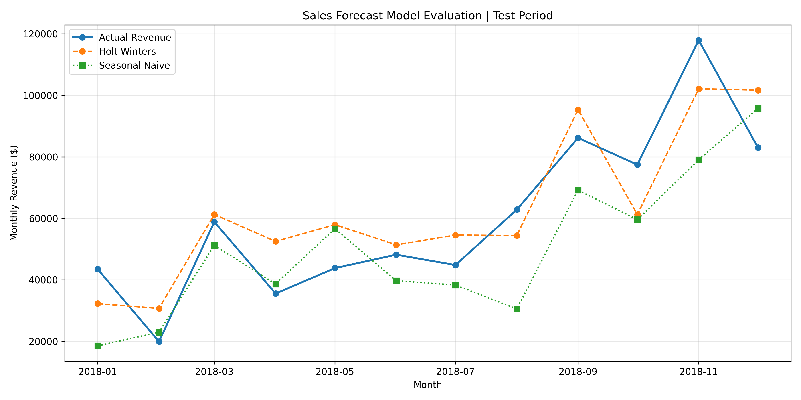
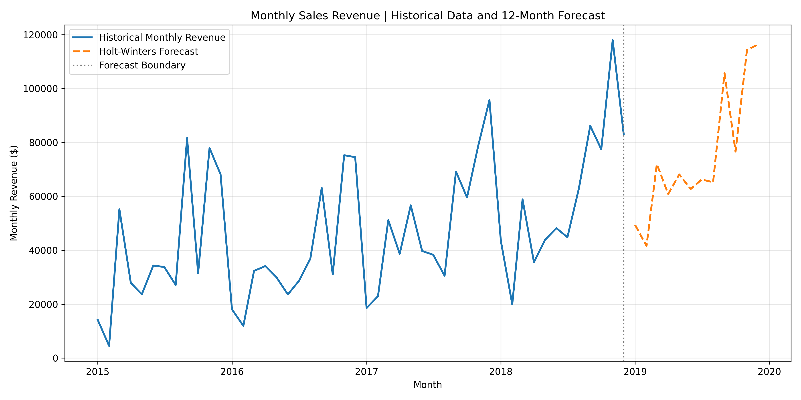

# Sales Forecasting Analysis | Python & Holt-Winters

## Project Overview

This project analyzes historical retail sales and uses time series forecasting to estimate future monthly revenue.

The analysis was performed in Python using the Holt-Winters Exponential Smoothing method. Historical sales data from 2015 to 2018 was used to identify revenue trends, evaluate forecasting performance, and generate a 12-month forecast for 2019.

The model was evaluated against a Seasonal Naive baseline using MAE, RMSE, and MAPE.

## Objectives

- Analyze historical monthly and annual sales performance.
- Identify revenue trends and seasonal patterns.
- Prepare transaction data for time series forecasting.
- Develop a Holt-Winters forecasting model.
- Evaluate forecasting accuracy using a chronological train/test split.
- Compare model performance against a Seasonal Naive baseline.
- Generate a 12-month sales forecast to support business planning.

## Tools and Technologies

- Python
- Pandas
- NumPy
- Matplotlib
- Statsmodels
- Scikit-learn
- GitHub

## Dataset

The dataset contains 9,800 retail transaction records covering the period from January 2015 to December 2018.

The analysis primarily uses the following fields:

| Column | Description |
|---|---|
| Order Date | Date of the customer order |
| Sales | Revenue associated with the transaction |

Transaction-level sales were aggregated into 48 monthly observations for time series analysis.

## Data Preparation

The dataset was imported and processed using Pandas.

The preparation process included:

- Converting order dates into datetime format.
- Checking for missing and invalid dates.
- Checking for missing and invalid sales values.
- Checking for duplicate records.
- Aggregating transaction-level sales into monthly revenue.
- Validating the continuity of the monthly time series.

The dataset contained no missing or invalid values in the Order Date and Sales fields, and no fully duplicated records.

## Historical Sales Analysis

The dataset contains four years of historical sales data.

| Year | Total Revenue ($) | Year-over-Year Growth |
|---|---:|---:|
| 2015 | 479,856.21 | N/A |
| 2016 | 459,436.01 | -4.26% |
| 2017 | 600,192.55 | 30.64% |
| 2018 | 722,052.02 | 20.30% |
| **Total** | **2,261,536.78** | |

### Business KPIs

- **Total Revenue:** $2,261,536.78
- **Average Monthly Revenue:** $47,115.35
- **Highest Revenue Month:** November 2018
- **Lowest Revenue Month:** February 2015

Revenue declined slightly in 2016 before increasing significantly in 2017 and 2018.

## Forecasting Methodology

### Train/Test Split

A chronological train/test split was used to evaluate forecasting performance without using future observations during model training.

| Dataset | Period | Observations |
|---|---|---:|
| Training | January 2015 – December 2017 | 36 months |
| Testing | January 2018 – December 2018 | 12 months |

### Holt-Winters Exponential Smoothing

The Holt-Winters model was configured with:

- Additive trend.
- Additive seasonality.
- Seasonal period of 12 months.

This configuration allows the model to capture changes in revenue levels, underlying trends, and recurring annual seasonal patterns.

### Seasonal Naive Baseline

A Seasonal Naive model was used as a benchmark.

This method predicts each month's revenue using the actual revenue from the corresponding month of the previous year.

Comparing Holt-Winters against this baseline helps determine whether the more complex forecasting method provides an improvement over a simple seasonal approach.

## Model Evaluation

Forecasting performance was evaluated on the 12-month test period using three metrics:

- **MAE (Mean Absolute Error):** Average absolute difference between actual and predicted revenue.
- **RMSE (Root Mean Squared Error):** Measures forecast errors while assigning greater weight to larger deviations.
- **MAPE (Mean Absolute Percentage Error):** Average absolute forecast error expressed as a percentage of actual revenue.

### Model Performance Comparison

| Model | MAE ($) | RMSE ($) | MAPE |
|---|---:|---:|---:|
| **Holt-Winters** | **11,390.78** | **12,436.98** | **22.76%** |
| Seasonal Naive | 15,444.18 | 18,932.10 | 24.86% |

Holt-Winters outperformed the Seasonal Naive baseline across all three evaluation metrics.

Compared with the baseline, Holt-Winters achieved approximately:

- 26.2% lower MAE.
- 34.3% lower RMSE.
- 2.10 percentage points lower MAPE.

However, a MAPE of 22.76% indicates that monthly forecast errors remain meaningful. The results should therefore be interpreted with appropriate caution.

### Actual vs Predicted Revenue



The chart compares actual monthly revenue during 2018 with predictions from both forecasting methods.

## Final 12-Month Sales Forecast

After model evaluation, Holt-Winters was fitted again using all 48 months of historical data to generate the final forecast for 2019.

| Forecast Period | Projected Revenue ($) |
|---|---:|
| January 2019 | 49,392.77 |
| February 2019 | 41,598.68 |
| March 2019 | 71,943.85 |
| April 2019 | 60,875.06 |
| May 2019 | 68,133.58 |
| June 2019 | 62,707.91 |
| July 2019 | 66,239.44 |
| August 2019 | 65,235.08 |
| September 2019 | 105,702.93 |
| October 2019 | 76,598.48 |
| November 2019 | 114,262.36 |
| December 2019 | 116,351.79 |
| **Total Forecast Revenue** | **899,041.94** |

The model projects approximately $899,042 in total revenue for 2019, representing an estimated increase of 24.5% compared with actual revenue in 2018.

This is a model-generated projection rather than a confirmed business outcome.

### Historical Revenue vs Forecast



The chart presents historical monthly revenue from 2015 to 2018 alongside the 12-month forecast for 2019.

## Key Findings

- Annual revenue increased substantially in 2017 and 2018 following a decline in 2016.
- The Holt-Winters model achieved lower forecasting errors than the Seasonal Naive baseline.
- The forecast suggests continued revenue growth in 2019, with higher projected sales toward the end of the year.
- Despite outperforming the baseline, the model's error levels indicate uncertainty in individual monthly predictions.

## Business Recommendations

Based on the analysis, the following approaches could be considered:

- **Inventory Planning:** Use seasonal sales forecasts as an input when estimating future stock requirements.
- **Resource Allocation:** Review staffing and operational capacity ahead of periods with higher projected revenue.
- **Financial Planning:** Incorporate forecasting scenarios into revenue targets and budgeting decisions.
- **Forecast Monitoring:** Compare actual sales against predictions regularly and update the model as new data becomes available.

These recommendations would require additional business information and further validation before implementation.

## Project Structure

```text
Sales-Forecasting-Python/
├── 01_Data/
│   └── raw_sales.csv
├── 02_Python/
│   └── forecasting.py
├── 03_Screenshots/
│   ├── 01_model_evaluation.png
│   ├── 02_final_sales_forecast.png
├── 04_Output/
│   ├── forecast_values.csv
│   ├── model_evaluation_metrics.csv
│   └── model_evaluation_predictions.csv
└── README.md
```

## How to Run the Analysis

Install the required Python libraries:

```bash
pip install pandas numpy matplotlib statsmodels scikit-learn
```

Run the analysis from the project directory:

```bash
python 02_Python/forecasting.py
```

The script performs data quality checks, calculates business KPIs, evaluates forecasting performance, generates the final 12-month forecast, and exports CSV files and visualizations.

## Conclusion

This project demonstrates the use of Python and Holt-Winters Exponential Smoothing to analyze historical retail sales and forecast future revenue.

The evaluation process shows that Holt-Winters performed better than a simple seasonal benchmark on the selected test period.

The analysis is limited to four years of historical data and one 12-month holdout period. Additional historical observations, rolling forecast evaluation, and external business factors could help improve the reliability of future forecasts.
